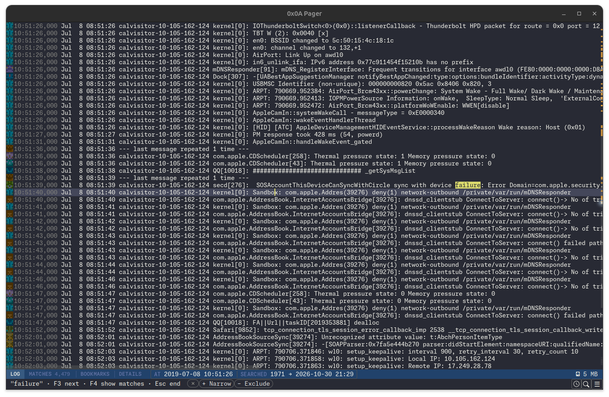

# 0x0A Pager

0x0A Pager is an opinionated log browser for Splunk® Enterprise, running as a desktop
application.

Its main purpose is to bring back the joy of browsing logs using old school
Unix pagers like `less` or `most` by providing a snappy and fluid user
interface. While the Splunk web interface and similar tools are powerful, it's often
cumbersome to quickly navigate through logs near or around a specific event of
interest. This tool aims to fix that.



## Features

- Endless, pager-style scrolling through a Splunk index.
- Search, step through matches and flip to a **Matches view** with only the matching events. Narrow or exclude the
  scope.
- Bookmark log entries, copy as text, JSON lines, CSV or HTML, and export to a file.
- Select across lines to see the time range and duration between the first and
  last selected line in the status bar.
- A minimap at the right edge shows where the matches and bookmarks are and what
  part you are looking at.
- Desktop, `less` and Emacs key aliases; press `h` for the key help.

## Install

Downloads are on the [releases page](https://github.com/kpihlblad/0x0a-pager/releases).

- **Windows:** unzip `0x0a-pager-windows.zip` and run `0x0a-pager\0x0a-pager.exe`.
  It includes its own Java runtime.
- **Debian and Ubuntu:** `sudo apt install ./pager-0x0a_<version>_amd64.deb`. It includes its own
  Java runtime and adds a menu entry.
- **Java** install Java 25 or later, then run `java -jar 0x0a-pager-<version>.jar`.

## Error Prone report

With JDK 25, run:

```bash
mvn -Perrorprone
```

This is shorthand for `mvn -Perrorprone clean test-compile`. It rebuilds and
analyzes production and test sources without running tests, then writes **`target/errorprone.txt`** with source
locations, check names, documentation
links and suggested fixes. Compiler diagnostics go to files rather than the
console. Normal `mvn compile`, `mvn test` and `mvn package` do not run Error Prone.

The audit runs all default-enabled Error Prone checks with no diagnostic count
limit. Findings are warnings so the scan can finish; actual compilation errors
still fail the build. If compilation fails, inspect `target/errorprone-main.txt`
and `target/errorprone-test.txt` (whichever compilation phases were reached).
These per-source-set files also include ordinary javac warnings and notes.
The combined report is produced only after both compilations succeed.

Keep `clean` when using the explicit command: Error Prone analyzes compiled
sources, so incremental builds can otherwise skip findings. Each clean run
replaces the previous report and other build outputs in `target/`.

Setup references: [Error Prone's Maven integration](https://errorprone.info/docs/installation#maven),
[report-only severity flags](https://errorprone.info/docs/flags),
[Maven profiles](https://maven.apache.org/guides/introduction/introduction-to-profiles.html),
and [javac diagnostic output options](https://docs.oracle.com/en/java/javase/25/docs/specs/man/javac.html#extra-options).

## Trademarks

0x0A Pager is an independent project and is not affiliated with, sponsored by or
endorsed by Splunk LLC or Cisco Systems, Inc.

Splunk, Splunk>, and Turn Data Into Doing are trademarks or registered
trademarks of Splunk LLC in the United States and other countries. All other
brand names, product names, or trademarks belong to their respective owners.
